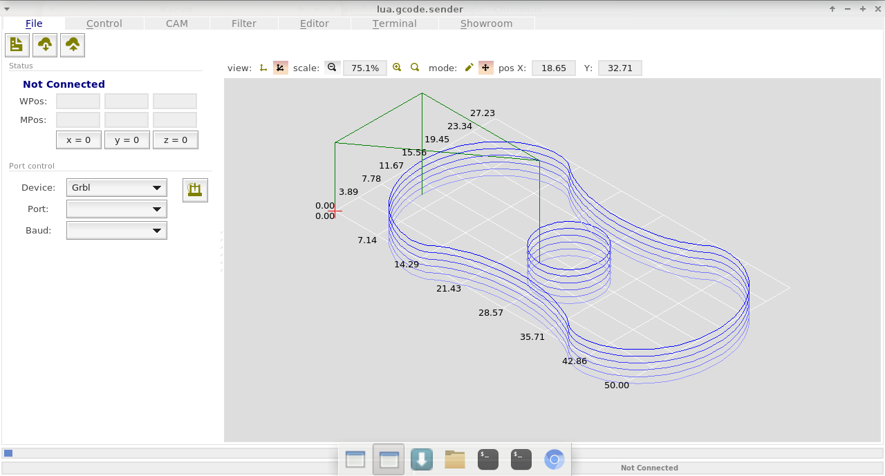
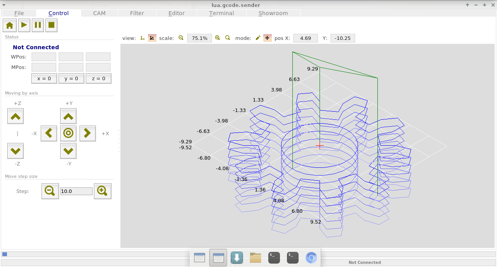
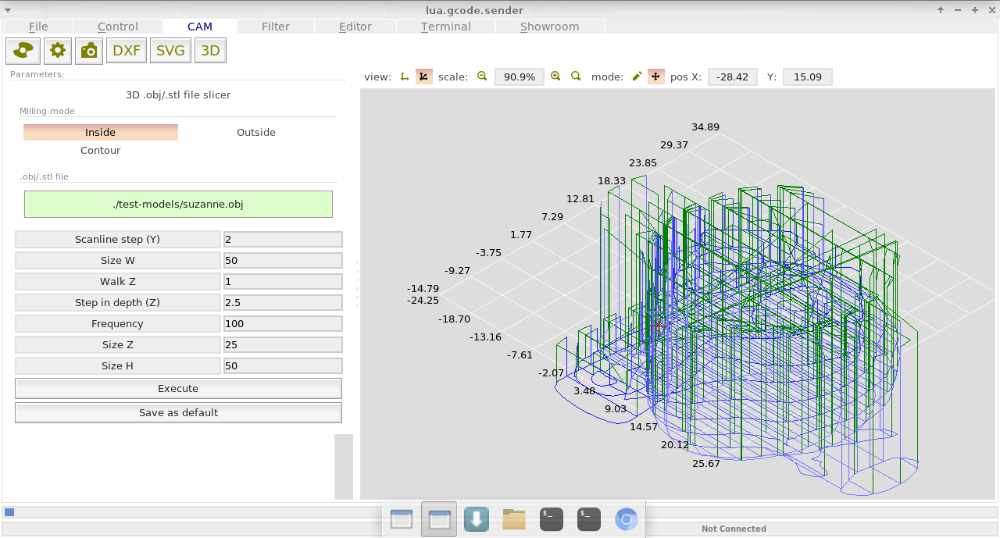
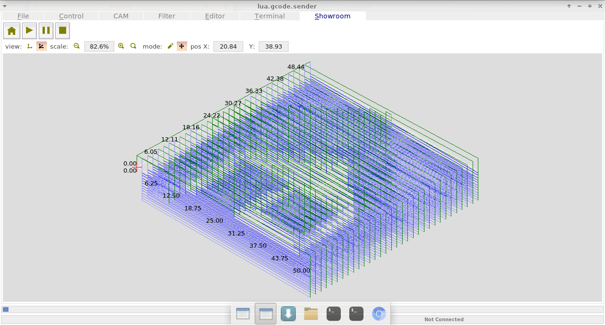

# lua.gcode.sender

Intro
-----
This is a highly configurable and changeable universal g-code sender for home-made CNC, laser & 3d printer. It doesn't contain any hard to port elements.
It has written using Lua & lua modules (lua, C, C++).

Supported hardware
----------
* [GRBL v0.9j](https://github.com/grbl/grbl)
* [GRBL v1.1](https://github.com/gnea/grbl) and firmware using its compatible serial protocol
* [Marlin v1 & v2](https://github.com/MarlinFirmware/Marlin/tree/bugfix-2.0.x)

Lua version
------
v5.3.3 (bit operations)

Used Lua plugins
-------
- http://hg.neoscientists.org/tekui/
- https://github.com/keplerproject/luafilesystem
- https://github.com/vsergeev/lua-periphery
- https://github.com/memononen/nanosvg
- https://bitbucket.org/Coin3D/dime (DXF reader library)

Dependencies to build
-------
* libreadline-dev
* libX11-dev
* libxft-dev
* libxext-dev
* libxxf86vm-dev


How to build
-------
Sources of lua-5.3.3 & all modules are included. Just run `bld.sh` script from the top of the project tree:
```sh
$ ./bld.sh 
```
Currently it is tested on linux-arm (Armbian, lUbuntu, Orange Pi PC - raspberry pi like) and linux-x86 (Ubuntu, xUbuntu)

How to execute
-------
```sh
$ cd bld
$ ./prg
```

How to change lua scripts
--------
all lua scripts are in the **bld/conf** folder. examples & docs to lua & modules are in their own folders.


Screenshots
-------









G-code storage and GRBL protocol
-------
G-code source, parsed lines, generator output and sender queues are held by
`gcodeparser.new_store()` userdata in the native parser module. Line numbers
are 1-based. Stores support `#store`, `store[n]`, `store[n] = text`,
`insert(n, text)`, `remove(n)`, `clear()`, `load(text)` and
`concat(separator, from, to)`. `load` preserves empty lines and accepts LF,
CRLF and CR line endings, including a last line without a newline.
`do_parse` now returns a native store instead of a Lua table. Rebuild the
parser module after updating the Lua scripts. The editor keeps only layout
and selection metadata in Lua; its text comes from the source store.

The existing GRBL controller accepts both comma-separated 0.9 reports and
pipe-separated 1.1 reports. It retains intermittent WCO offsets to compute
machine/work positions, ignores unknown status fields and does not overwrite
`$10`. Streaming waits for `ok`/`error:`; realtime status queries do not consume
acknowledgements. Serial fragments are retained until a complete response
arrives. Alarms and controller resets stop the current stream.
Newer firmware is supported when it retains this protocol; vendor extensions
and additional axes are not exposed by the existing XYZ interface.

Regression checks
-------
Run `./tests/run.sh` with make, gcc and g++ installed. It builds bundled Lua
without readline, builds the parser separately, tests native storage,
callbacks, editor text access, selected-range preparation, independent Lua
states and GRBL serial responses, and checks the Lua configuration syntax.
Serial I/O is mocked; these checks do not replace a test on a real controller.

Relative linear moves (G91) retain incremental coordinates when transformed:
translation cancels from each increment, while rotation/scaling apply to the
increment vector. The preview accumulates these increments, and applies G90/G91
and G0/G1 to the whole block regardless of word order. Empty drawings have zero
bounds. Single-command queues use FIFO order. Paused jobs reject single moves;
resume continues after the acknowledged block. GRBL Stop sends Ctrl-X and waits
for the startup banner before allowing another line. This aborts controller
motion and resets its parser state; it is distinct from feed hold (Pause).
`tests/sender.lua` exercises the actual sender task with a mocked controller.

File panel New clears both native stores and resets the filename. Open keeps
blank source lines; Save writes edited source rows from the native store (LF
line endings and a final newline), and requests a filename for a new program.
File errors are shown in the status bar. Tests cover loading, saving, failed
writes and the actual file-panel callbacks.

Preview parsing commits new results only on success. Invalid print ranges and
parse failures leave the sender queue untouched. Controller errors discard the
current job; Resume cannot retry a failed block. ALARM stops the job while still
allowing a deliberate single unlock command such as `$X`.

Writing a program from scratch
-------
Open Editor and use New program in the file toolbar to clear the source. Type a
line in the input below the command list and press Enter: it saves that line,
inserts the next blank line and keeps keyboard focus in the input. Update saves
without inserting a line and also creates the first row of an empty program.
New inserts a blank row after the selection; Delete selects the next available
row or returns to an empty program. Every edit uses the native source store and
the same parser as loaded files. Syntax errors appear in the status bar; valid
edits refresh the drawing when AutoUpdate drawing is enabled. With automatic
redraw disabled, validation still runs and Update drawing refreshes the preview.
Enter does not transmit commands; Send sel is the explicit controller action.
Save and the existing print controls work with programs entered in this way.

Search patterns and replacement strings are checked before modifying source.
An empty replacement removes the match. Empty, single-point and single-axis
previews have finite drawing scales in both XY and XYZ projections.
`tests/editor.lua` exercises the actual editor button callbacks with the native
parser; `tests/render.lua` checks the drawing code with a mock drawable.

The editor also commits unconfirmed input before Save and before starting a new
print, so pressing Enter first is not required. Invalid source may still be
saved for later editing, but parsing must succeed before any print commands are
queued. Parser errors include the first syntax-error line and column; the
editor selects the corresponding source row for correction.

Arc output
-------
Editor has an **Approximate arcs (G1)** checkbox, enabled by default. With it
checked, G2/G3 blocks become separate G1 segments; with it unchecked, native
arc commands are sent. GRBL itself supports G2/G3. Preview uses sampled arcs
in either mode, including full circles, signed R radii and helical Z motion.
The original program remains unchanged in the source store. Expanded sender
commands retain their source row, including controller error reports.

The current implementation supports G17 XY arcs with incremental I/J centers
or R. G18/G19 arcs and G90.1 centers are rejected. G93 inverse-time feed cannot
be approximated and is rejected in G1 mode. Native circular output requires
equal nonzero absolute XY scales; approximation can represent nonuniform scale.
Rotation and reflection transform centers and endpoints; reflection reverses
native G2/G3 direction. Drawing bounds transform all eight bounding-box corners.

`Flags.ArcTolerance` defaults to 0.01 millimetres. It limits
chord error before four-decimal command rounding, accounts for XY scaling, and
is also used for preview sampling. Segment count is limited to 100000 per arc;
relative command rounding is accumulated to keep the final endpoint consistent.
Run `tests/arcs.lua` through `tests/run.sh` for geometry and output regressions.

Editor history and file replacement
-------
Undo/Redo keep up to 20 edit snapshots in native stores, including source text,
selection and print range. A new edit clears redo, and New/Open clear the history.
Native `clone()` and `copy_from(store)` copy source without Lua arrays.

Save writes a unique temporary file in the destination directory, flushes and
syncs it, preserves existing regular-file permission bits and atomically renames
it over the destination after success. Failed writes remove the temporary file
and preserve the previous destination. Devices, directories and symlink targets
are rejected. This save implementation uses POSIX file APIs.

Preview positions and transformation offsets now use millimetres internally.
G20/G21 changes are respected throughout a program, including G91 increments,
arc centers, helical interpolation and output coordinates. Prepared commands
retain the source unit modes and values; preview sampling tolerance is in mm.
