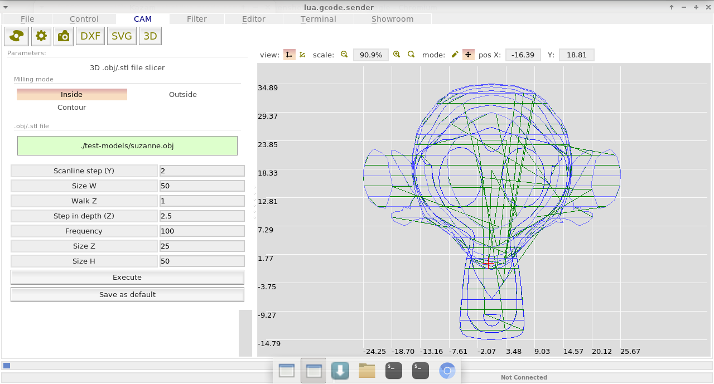
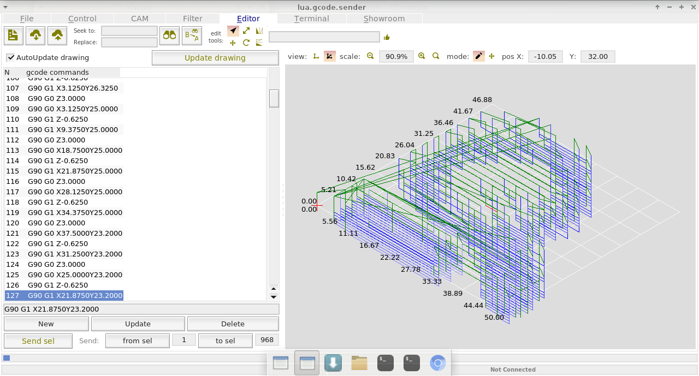
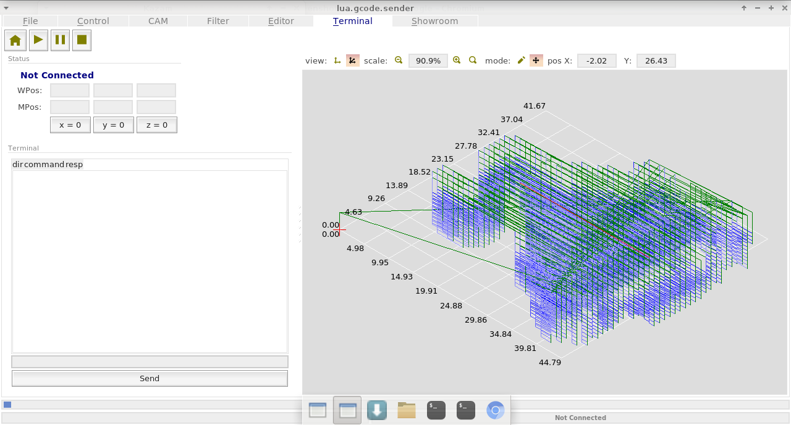

# lua.gcode.sender

Intro
-----
This is a highly configurable and changeable universal g-code sender for home-made CNC, laser & 3d printer. It doesn't contain any hard to port elements.
It has written using Lua & lua modules (lua, C, C++).

Supported hardware
----------
* [GRBL v0.9j](https://github.com/grbl/grbl)
* [GRBL v1.1](https://github.com/gnea/grbl) and firmware using its compatible serial protocol
* [Marlin v1 & v2](https://github.com/MarlinFirmware/Marlin/tree/bugfix-2.0.x)

Lua version
------
v5.3.3 (bit operations)

Used Lua plugins
-------
- http://hg.neoscientists.org/tekui/
- https://github.com/keplerproject/luafilesystem
- https://github.com/vsergeev/lua-periphery
- https://github.com/memononen/nanosvg
- https://bitbucket.org/Coin3D/dime (DXF reader library)

Dependencies to build
-------
* libreadline-dev
* libX11-dev
* libxft-dev
* libxext-dev
* libxxf86vm-dev


How to build
-------
Sources of lua-5.3.3 & all modules are included. Just run `bld.sh` script from the top of the project tree:
```sh
$ ./bld.sh 
```
Currently it is tested on linux-arm (Armbian, lUbuntu, Orange Pi PC - raspberry pi like) and linux-x86 (Ubuntu, xUbuntu)

How to execute
-------
```sh
$ cd bld
$ ./prg
```

How to change lua scripts
--------
all lua scripts are in the **bld/conf** folder. examples & docs to lua & modules are in their own folders.


Screenshots
-------









G-code storage and GRBL protocol
-------
G-code source, parsed lines, generator output and sender queues are held by
`gcodeparser.new_store()` userdata in the native parser module. Line numbers
are 1-based. Stores support `#store`, `store[n]`, `store[n] = text`,
`insert(n, text)`, `remove(n)`, `clear()`, `load(text)` and
`concat(separator, from, to)`. `load` preserves empty lines and accepts LF,
CRLF and CR line endings, including a last line without a newline.
`do_parse` now returns a native store instead of a Lua table. Rebuild the
parser module after updating the Lua scripts. The editor keeps only layout
and selection metadata in Lua; its text comes from the source store.

The existing GRBL controller accepts both comma-separated 0.9 reports and
pipe-separated 1.1 reports. It retains intermittent WCO offsets to compute
machine/work positions, ignores unknown status fields and does not overwrite
`$10`. Streaming waits for `ok`/`error:`; realtime status queries do not consume
acknowledgements. Serial fragments are retained until a complete response
arrives. Alarms and controller resets stop the current stream.
Newer firmware is supported when it retains this protocol; vendor extensions
and additional axes are not exposed by the existing XYZ interface.

Regression checks
-------
Run `./tests/run.sh` with make, gcc and g++ installed. It builds bundled Lua
without readline, builds the parser separately, tests native storage,
callbacks, editor text access, selected-range preparation, independent Lua
states and GRBL serial responses, and checks the Lua configuration syntax.
Serial I/O is mocked; these checks do not replace a test on a real controller.
